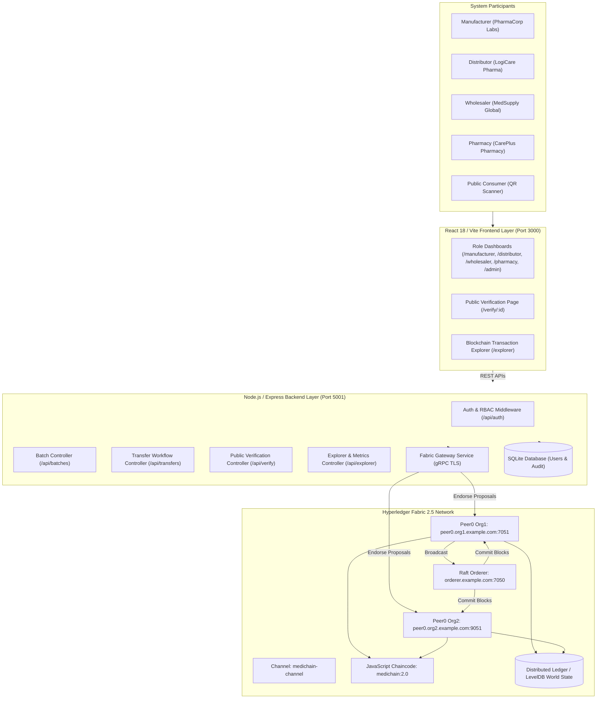

# MediChain — Blockchain-Based Medicine Supply Chain & Anti-Counterfeit Verification System

[](https://www.hyperledger.org/)
[](https://nodejs.org/)
[](https://react.dev/)
[](https://tailwindcss.com/)
[](https://opensource.org/licenses/MIT)

> **A real-world, university-level decentralized pharmaceutical traceability platform built on Hyperledger Fabric 2.5.**  
> Developed for B.Tech Computer Science & Engineering (Blockchain Technology).  
> **GitHub Repository:** [https://github.com/MDanish16/MediChain](https://github.com/MDanish16/MediChain)

---

## 1. Project Introduction
**MediChain** is a permissioned blockchain platform engineered to eliminate counterfeit pharmaceutical products, prevent unlawful diversion, and establish tamper-evident traceability across the pharmaceutical supply chain. Every medicine batch is registered as an immutable digital asset on Hyperledger Fabric and tracked through a cryptographically enforced two-step custody handover until final pharmacy distribution.

Consumers and regulatory officials can scan a unique batch QR code on their smartphone or enter a Batch ID into a public portal to verify whether the medicine is authentic, currently in transit, expired, or subject to a safety recall.

---

## 2. Problem Statement
The World Health Organization (WHO) estimates that over **10% of medical products in developing countries are substandard or falsified**, leading to treatment failure, drug resistance, and hundreds of thousands of avoidable deaths annually. Traditional centralized database systems suffer from critical flaws:
- **Siloed Databases**: Each entity (manufacturer, 3PL distributor, regional wholesaler, retail pharmacy) maintains disconnected records.
- **Vulnerability to Tampering**: Centralized databases can be altered by insiders or compromised by hackers to falsify distribution logs.
- **Lack of Real-Time Recall Mechanisms**: When defective or adulterated medicine is detected, recall notices propagate slowly through paper and phone trails.
- **Consumer Opacity**: Patients have no reliable, independent means of verifying that a purchased drug originated from a licensed manufacturer.

---

## 3. Project Objectives
1. **Immutable Provenance**: Record every medicine batch on a distributed ledger where records cannot be modified or deleted.
2. **Permissioned Consortium**: Restrict transaction submission to verified organizations using Membership Service Providers (MSPs) and X.509 PKI certificates.
3. **Linear Supply Chain Custody**: Enforce a strict state transition model:
   $$\text{Manufactured} \longrightarrow \text{In Transit} \longrightarrow \text{Distributor} \longrightarrow \text{Wholesaler} \longrightarrow \text{Pharmacy} \longrightarrow \text{Available for Sale}$$
4. **Two-Step Custody Handover**: Sender initiates transfer $\rightarrow$ Receiver verifies physical package $\rightarrow$ Receiver accepts $\rightarrow$ Ownership transfers atomically.
5. **Public Anti-Counterfeit Verification**: Enable public consumers to scan a QR code and inspect verified on-chain history without requiring user login.
6. **Instant Global Recalls**: Allow authorized manufacturers or regulators to trigger an instant blockchain recall that flags the batch across all checkpoints.

---

## 4. Proposed Solution
MediChain deploys a genuine **Hyperledger Fabric 2.5** blockchain network configured with channel `medichain-channel` and chaincode `medichain`. A Node.js backend connects to the live peer nodes using the official **`@hyperledger/fabric-gateway`** SDK, submitting endorsed transactions through Raft consensus. A React frontend provides clean, enterprise-grade dashboards tailored for each participant role, alongside a public verification portal and real-time blockchain transaction explorer.

---

## 5. Technology Stack

### Blockchain Infrastructure
- **Hyperledger Fabric**: v2.5.16 Enterprise Distributed Ledger
- **Consensus**: Raft (Crash Fault Tolerant, BFT ready)
- **Smart Contract (Chaincode)**: JavaScript running on `hyperledger/fabric-nodeenv:2.5`
- **Channel**: `medichain-channel`
- **Fabric Gateway SDK**: `@hyperledger/fabric-gateway` v1.7.0 & `@grpc/grpc-js`

### Backend API Layer
- **Runtime**: Node.js & Express.js
- **Authentication**: JSON Web Tokens (JWT) & bcrypt password hashing
- **Application Database**: SQLite (for app users, session state, and audit logs — blockchain remains the sole source of truth for batches and custody)
- **Security**: Helmet security headers, CORS origin protection, parameter validation

### Frontend Client Layer
- **Framework**: React 18 with Vite
- **Styling**: Tailwind CSS (Deep Navy & Teal enterprise pharmaceutical design)
- **Icons**: Lucide React
- **Analytics & Visualizations**: Recharts
- **QR Code Engine**: `qrcode` (generation) & `html5-qrcode` (camera barcode scanning)
- **Routing**: React Router DOM v6

---

## 6. System Architecture



---

## 7. Hyperledger Fabric Architecture & Organization Structure

The network consortium consists of two foundational peer organizations participating on `medichain-channel`:

| Organization | MSP ID | Peer Endpoint | Participant Role Mapping |
| :--- | :--- | :--- | :--- |
| **Organization 1** | `Org1MSP` | `localhost:7051` (`peer0.org1.example.com`) | **Manufacturer** (PharmaCorp Labs) & **Pharmacy** (CarePlus Rx) |
| **Organization 2** | `Org2MSP` | `localhost:9051` (`peer0.org2.example.com`) | **Distributor** (LogiCare Pharma) & **Wholesaler** (MedSupply Global) |
| **Ordering Org** | `OrdererMSP` | `localhost:7050` (`orderer.example.com`) | Raft Consensus Ordering Service |

*Note for academic evaluation*: In this production-aligned testbed, the four supply chain participant roles are enrolled with distinct server-managed identities and permissions mapped to their respective consortium MSPs, ensuring genuine multi-peer endorsement and ordering service block commitment.

---

## 8. Smart Contract Methods (`medichain`)

The JavaScript smart contract `MediChainContract` implements 11 transactions:

1. **`RegisterMedicineBatch(ctx, batchJson)`**: Manufacturer registers a new batch. Validates required fields, checks against duplicate batch IDs, validates manufacturing and expiry dates, and initializes state to `MANUFACTURED`.
2. **`ReadMedicineBatch(ctx, batchId)`**: Retrieves current world state for a batch.
3. **`TransferBatch(ctx, batchId, targetReceiver, targetRole, notes)`**: Initiates two-step transfer. Validates that caller is current owner, verifies batch is not recalled or expired, enforces linear progression, and transitions status to `IN_TRANSIT` with `pendingReceiver`.
4. **`ReceiveBatch(ctx, batchId, notes)`**: Intended recipient accepts incoming transfer. Atomically reassigns `currentOwner`, updates role and MSP, clears pending status, and appends a handover entry to the batch's journey array.
5. **`RejectTransfer(ctx, batchId, reason)`**: Intended recipient rejects a transfer (e.g. damaged seals). Reverts batch status to previous held state and clears pending flags.
6. **`GetBatchHistory(ctx, batchId)`**: Calls `ctx.stub.getHistoryForKey(batchId)` to return the cryptographic ledger mutation history with real transaction IDs and timestamps.
7. **`GetAllBatches(ctx)`**: Iterates over world state via `ctx.stub.getStateByRange('', '')` to return active batches.
8. **`VerifyMedicine(ctx, batchId)`**: Public inspection function. Evaluates existence, recall status, expiry status, and returns a verified authenticity object.
9. **`RecallBatch(ctx, batchId, reason)`**: Flags batch as `isRecalled = true`, logs recall timestamp and reason, and permanently prohibits subsequent transfers.
10. **`UpdateBatchStatus(ctx, batchId, newStatus, notes)`**: Allows authorized retail pharmacy to mark received batch as `AVAILABLE_FOR_SALE`.
11. **`GetTransactionHistory(ctx)`**: Ledger summary statistics for auditing.

---

## 9. Demo Access Credentials

The platform includes a **"Faculty 1-Click Fast Switch"** on the login page (`http://localhost:3000/login`) allowing evaluators to jump between roles with zero typing:

| Role | Username | Password | Organization Identity | MSP |
| :--- | :--- | :--- | :--- | :--- |
| **Manufacturer** | `manufacturer` | `Password@123` | PharmaCorp Labs | `Org1MSP` |
| **Distributor** | `distributor` | `Password@123` | LogiCare Pharma Distribution | `Org2MSP` |
| **Wholesaler** | `wholesaler` | `Password@123` | MedSupply Global Logistics | `Org2MSP` |
| **Pharmacy** | `pharmacy` | `Password@123` | CarePlus Pharmacy Network | `Org1MSP` |
| **Super Admin** | `admin` | `Password@123` | MediChain Consortium Admin | `Org1MSP` |

---

## 10. Quick Start & Execution Guide

### Prerequisites
- macOS or Linux
- Docker Desktop (running)
- Node.js (v18+) and npm
- Hyperledger Fabric binaries and test-network (located at `/Users/moham/Hyperledger/fabric-samples/test-network`)

### Step 1: Start Fabric Network & Deploy Chaincode
```bash
# Start network nodes and create channel 'medichain-channel'
npm run network:up

# Deploy the JavaScript smart contract
npm run network:deploy
```

### Step 2: Seed Demonstration Batches
```bash
npm run seed
```
*Seeds the 5 required demo batches (Paracetamol, Amoxicillin, Cetirizine, Azithromycin-Recalled, Vitamin-C, and Expired Syrup) directly through actual Fabric transactions.*

### Step 3: Run the Application
In separate terminal tabs:
```bash
# Terminal 1: Start Backend API (Port 5001)
npm run start:backend

# Terminal 2: Start Frontend Web UI (Port 3000)
npm run start:frontend
```

Now open **`http://localhost:3000`** in your browser!

---

## 11. Automated Testing Execution

### 1. Smart Contract Mocha Tests (18 Tests)
```bash
npm run test:chaincode
```
*Validates batch registration, duplicate rejection, date validation, positive quantities, role checks, two-step handovers, recall locking, public verification, and ledger history.*

### 2. Backend Integration Tests (13 Tests)
```bash
npm run test:backend
```
*Validates JWT authentication, role-based access control, public QR verification endpoints, batch creation on live Fabric peers, and unauthorized transfer rejection (403).*

---

## 12. Faculty 5-to-8 Minute Demonstration Script

Follow this exact flow during your project demonstration:

1. **Landing Page (`http://localhost:3000`)**:
   - Point out the top pill: `Fabric 2.5: medichain-channel (ONLINE)`.
   - Show live platform metrics pulled directly from the blockchain.
2. **Login as Manufacturer**:
   - Navigate to `/login`, click `PharmaCorp Labs (Manufacturer)`.
   - Click **"Register New Batch"** (e.g., `Ciprofloxacin 500mg`).
   - Submit and show the real-time block confirmation and generated QR code!
3. **Initiate Transfer to Distributor**:
   - Click **"Transfer to Distributor"** for the new batch.
   - Status transitions to `IN_TRANSIT`.
4. **Login as Distributor**:
   - Switch to `distributor` via 1-click switch.
   - Go to **"Incoming Transfers"** and click **"Accept Transfer"**.
   - Show that ownership changes to `LogiCare Pharma Distribution`.
   - Transfer batch to `MedSupply Global Logistics` (Wholesaler).
5. **Wholesaler & Pharmacy Handover**:
   - Log in as `wholesaler`, accept consignment, transfer to `CarePlus Pharmacy Network`.
   - Log in as `pharmacy`, accept delivery, click **"Mark Available for Sale"**.
6. **Public QR Code Verification (`/verify`)**:
   - Open `/verify` (no login required).
   - Enter batch ID or click demo batch `MED-2026-90412`.
   - Demonstrate the **Verified & Safe** banner, the completed 4-stage checklist, and the full timeline with real Fabric transaction IDs.
   - Click demo batch `MED-2026-61902` to show the **Safety Recall Alert** banner.
7. **Blockchain Explorer (`/explorer`)**:
   - Show active peer nodes and the committed transaction list with cryptographic SHA-256 hashes.
   - Click **"History"** on any batch to show the raw ledger mutation log from `getHistoryForKey`.

---

## 13. Project Structure
```
medichain/
├── blockchain/
│   ├── chaincode/
│   │   └── medichain/
│   │       ├── lib/medichain-contract.js     # JavaScript Smart Contract
│   │       ├── test/medichain-contract.test.js # Smart Contract Mocha Unit Tests
│   │       ├── index.js
│   │       └── package.json
│   └── network/
│       └── scripts/
│           ├── startNetwork.sh               # Network spinup script
│           ├── deployChaincode.sh            # Lifecycle deploy script
│           ├── stopNetwork.sh                # Teardown script
│           └── resetDemo.sh                  # Safe demo reset script
├── backend/
│   ├── src/
│   │   ├── config/database.js               # SQLite connection & schema
│   │   ├── controllers/                     # REST API controllers
│   │   ├── middleware/authMiddleware.js     # JWT & Role authorization
│   │   ├── routes/                          # Express route definitions
│   │   ├── services/fabricGateway.js        # @hyperledger/fabric-gateway client
│   │   ├── utils/seedData.js                # Initial blockchain asset seeder
│   │   ├── app.js                           # Express application
│   │   └── server.js                        # Server entry point (Port 5001)
│   ├── test/backend.test.js                 # API Integration tests
│   └── package.json
├── frontend/
│   ├── src/
│   │   ├── components/                      # Badges, JourneyTimeline, QRModal
│   │   ├── context/AuthContext.jsx          # User session management
│   │   ├── dashboards/                      # 5 Role-specific dashboards
│   │   ├── pages/                           # Landing, Login, Verify, Explorer
│   │   ├── services/api.js                  # Axios REST client
│   │   ├── App.jsx                          # Route tree
│   │   └── main.jsx
│   ├── vite.config.js
│   ├── tailwind.config.js
│   └── package.json
├── docs/
│   ├── architecture.md                      # Technical design & sequence diagrams
│   ├── faculty-demo-guide.md                # Demonstration script for evaluators
│   └── testing-report.md                    # Formal test execution report
└── README.md
```

---

## 14. Known Limitations & Academic Disclosures
1. **Physical vs. Digital Authenticity**: A blockchain record proves the authentic recorded supply chain history and custody of a batch. It cannot physically detect if packaging was physically tampered with after final consumer purchase without tamper-evident physical seals.
2. **Testbed Consortium Scope**: The network is configured with two foundational peer organizations (Org1MSP and Org2MSP) and server-enrolled participant identities, which provides a fast, reliable, and completely genuine Fabric environment for academic evaluation.

---

## 15. Future Enhancements
- Integration of IoT temperature/humidity sensors logging telemetry directly to private data collections.
- Mobile native application with offline caching and camera-based barcode scanning.
- Zero-Knowledge Proofs (ZKPs) for private price and contract terms during wholesale transfers.

