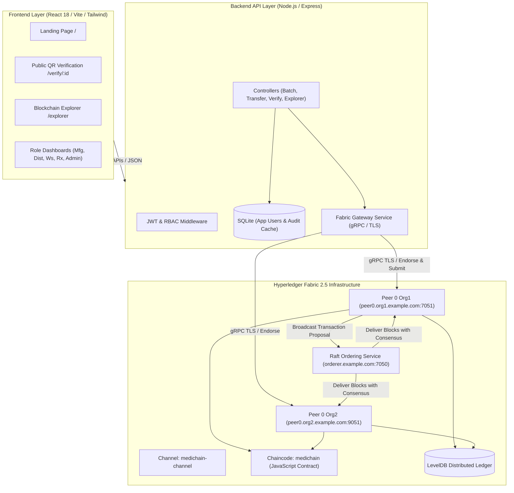
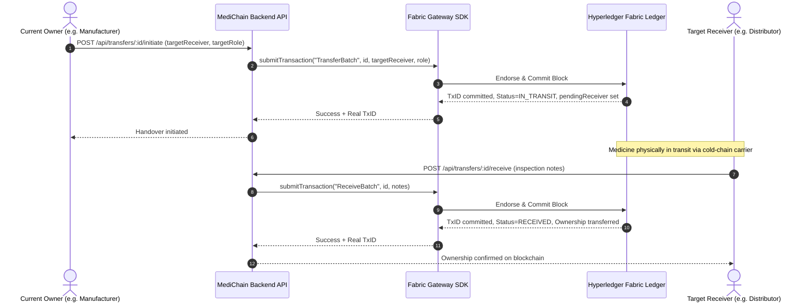

# MediChain — System Architecture & Technical Design

## 1. System Overview
MediChain is an enterprise-grade pharmaceutical supply chain traceability platform. It leverages **Hyperledger Fabric 2.5** to create an immutable, distributed ledger that records the life cycle of every manufactured medicine batch.

---

## 2. Supply Chain Two-Step Handover Workflow

---

## 3. Blockchain Consensus & State Model

### Ledger Structure
Every medicine batch is represented as an asset key on the channel:
- Key: Unique Batch ID (e.g., `MED-2026-90412`)
- Value: JSON serialized `MedicineBatch` struct
- State Database: LevelDB embedded in each peer node

### Cryptographic Identities
- Identities are backed by X.509 PKI certificates generated via Fabric Cryptogen.
- Org1MSP and Org2MSP define the consortium trust boundaries.
- Fabric Gateway authenticates calls using User1 signcert and ECDSA private key.

